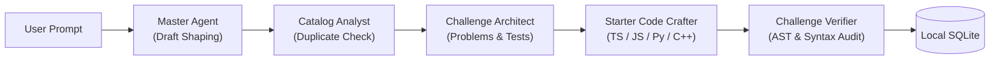

<div align="center">
  
  <h1>AlgoVault</h1>
  <p>
    <strong>Local-first, offline-capable Data Structures &amp; Algorithms workspace</strong><br />
    Sandboxed QEMU micro-VM execution · Multi-agent AI challenge generation · Gamified Marathon quest maps
  </p>
</div>

---

## Why AlgoVault?

AlgoVault brings a full algorithmic practice environment directly to your desktop—no cloud lock-in, no internet requirement for solving or running code, and no unsafe host execution. Write solutions in **TypeScript**, **JavaScript**, **Python**, or **C++**, run them inside an isolated offline Linux micro-VM, generate custom problem sets and Marathon tracks with AI, and share your progress card with the community.

---

## Quick Start

### Prerequisites
- **Node.js** 20+ and **pnpm**
- **Docker** *(for building the Alpine Linux sandbox `rootfs.ext4` and Buildroot kernel)*
- **macOS QEMU build tools** *(only when compiling QEMU from source)*:
  ```bash
  brew install ninja pkg-config glib pixman
  ```

### Run in Development

```bash
pnpm install
pnpm run dev
```

### Build & Smoke-Test the Sandbox Micro-VM

```bash
# macOS x64 (Intel / Rosetta)
pnpm run vm:x64

# macOS arm64 (Apple Silicon)
pnpm run vm:arm
```

---

## Key Features

### 1. Multi-Language Challenge Workspace
- **Monaco Editor** with per-language draft tracking and automatic starter-template isolation across `typescript`, `javascript`, `python`, and `cpp`.
- **AST Test Harness & Static Checks**: Babel-based TypeScript static type checking (`TypeCheckerService`) and AST signature extraction (`babelInjector.ts`) to run user solutions against deterministic visible and hidden test cases.
- **In-Challenge AI Tutor**: Embedded conversational tutor (`challenge-explainer.subagent.ts`) grounded in the active challenge statement, examples, constraints, and your current editor buffer.
- **Solution Performance Coach**: Automated time/space complexity analysis and optimization feedback (`solution-feedback.subagent.ts`) with duplicate-code caching.

### 2. Isolated Micro-VM Code Sandbox (`electron/modules/engine-runner/`)
- Runs user submissions inside an offline **Alpine Linux** guest (`rootfs.ext4`) booted via **QEMU** (`qemu-system-x86_64` / `qemu-system-aarch64`) with `-nic none` (zero network access) and a custom Buildroot Linux kernel (`Image`).
- Guest runner (`agent.py`) compiles and executes TypeScript, JavaScript, Python 3, and C++ (`g++`) with strict isolation.

### 3. Questions Factory — Multi-Agent AI Pipeline (`electron/modules/ai/`)
Turn natural-language prompts into verified, multi-language challenges saved directly to local SQLite:



- **Master Agent**: Conversationally shapes the generation draft (`category`, `topic`, `contentType`, `difficulty`, `questionCount`, `questionStyle`) and orchestrates the pipeline.
- **Catalog Analyst**: Inspects existing workspace categories and titles to avoid duplicates.
- **Challenge Architect**: Designs problem descriptions (Markdown + KaTeX), constraints, hints, examples, deterministic test suites, and Marathon milestone labels.
- **Starter Code Crafter**: Dedicated subagent that crafts formatted, idiomatic, self-contained starter code in all 4 languages—including custom `Node`, `ListNode`, `TreeNode`, or `Interval` definitions whenever needed.
- **Challenge Verifier**: Audits TypeScript syntax, per-language starter code validity, custom-type declarations, and test-case completeness as a hard gate before persistence.

### 4. Gamified Marathon Tracks & Quest Maps
- **Dual View (`Questions` | `Map`)**: Switch between a searchable/filterable challenge list and an interactive **`@xyflow/react`** Quest Map.
- **Interactive Skill Tree**: Drag-to-pan, scroll-to-zoom, minimap, animated dashed Bezier paths, AI-labeled milestone pills, trophy checkpoints, and progressive stage unlocking.

### 5. Local Profile, Heatmap & Social PNG Sharing
- **Onboarding & Avatars**: Local SQLite profile (`UserProfileEntity`) with 26 bundled 3D avatars.
- **Contribution Heatmap**: GitHub-style 52-week contribution grid and lazy-loaded monthly activity timeline.
- **Social Share Card**: Offscreen 2× Retina HTML5 Canvas exporter (`exportProfilePng.ts`) that renders your avatar, handle, solved stats, streaks, and contribution heatmap for one-click clipboard copy or PNG download.

---

## Project Structure

```text
AlgoVault/
├── electron/
│   ├── main.ts                         # Electron main process, window lifecycle, IPC setup
│   ├── preload.ts                      # Secure contextBridge APIs
│   ├── splash.ts                       # Startup splash screen HTML builder
│   └── modules/
│       ├── ai/                         # Vercel AI SDK multi-agent pipeline & services
│       ├── code-test/                  # TypeORM entities, SQLite services, IPC controllers
│       ├── database/                   # SQLite connection & database module
│       └── engine-runner/              # QEMU micro-VM runner, Alpine Dockerfile & scripts
├── src/
│   ├── app/                            # Top-level workspace orchestration
│   ├── assets/                         # Bundled 3D avatars, app logo, cover images
│   ├── layout/                         # PersistentRail, TopHeader, AppLayout
│   ├── modules/
│   │   ├── challenge/                  # Monaco editor, test runner, AI tutor & coach
│   │   ├── home/                       # HomeScreen, MarathonCarousel, MarathonQuestMap
│   │   ├── profile/                    # Onboarding, ProfileScreen, Heatmap, PNG export
│   │   ├── questions-factory/          # Conversational AI Questions Factory UI & draft panel
│   │   ├── settings/                   # AI provider & API key management
│   │   ├── favorites/ & todos/         # Bookmarks and study task tracking
│   └── shared/                         # Shared store (Jotai), IPC clients, types, utils
└── public/                             # Static assets & promotional SVGs
```

---

## Testing & Packaging

```bash
# Multi-agent AI pipeline integration tests (MockLanguageModelV4 + SQLite)
pnpm run ai:test

# Typecheck & strict ESLint
./node_modules/.bin/tsc --noEmit
pnpm run lint

# Package Electron app for macOS
pnpm run build:mac:arm64
pnpm run build:mac:x64
```

---

## Contributing

**Let's make AlgoVault better!**  
Have an idea, bug fix, new challenge pack, or language runner improvement? Contributions are always welcome:

1. Fork [DjibrilM/AlgoVault](https://github.com/DjibrilM/AlgoVault)
2. Create a feature branch (`git checkout -b feat/your-feature`)
3. Run `tsc --noEmit`, `pnpm run lint`, and `pnpm run ai:test`
4. Open a Pull Request
