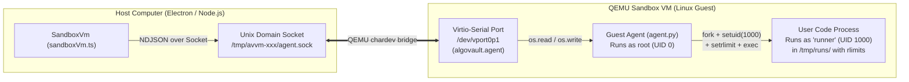

# AlgoVault Engine Runner

Welcome to the **Engine Runner** — the secure sandbox that compiles and runs untrusted user code (Python, JavaScript, TypeScript, C, and C++) inside AlgoVault.

When someone submits code to solve an algorithm problem, we have to assume that code might accidentally (or intentionally!) try to:
- Run forever in an infinite loop (`while True: pass`)
- Eat up all the computer's memory
- Spawn thousands of copies of itself (a "fork bomb")
- Delete files on the user's Mac or Windows PC
- Connect to the internet to cheat or steal data

To ensure untrusted code can never affect the host machine, the Engine Runner boots a **lightweight, isolated Linux Virtual Machine** with no network interface, sends execution jobs across a single point-to-point serial channel, runs the code under strict kernel resource limits, and streams the results back.

This document explains how the system works from top to bottom — including the architecture, the socket protocol, and every low-level Linux kernel mechanism used inside the guest.

---

## Table of Contents

1. [Architecture Overview](#1-architecture-overview)
2. [Directory Layout](#2-directory-layout)
3. [How the Virtual Machine Boots](#3-how-the-virtual-machine-boots)
4. [Socket Communications: Host-to-Guest Transport](#4-socket-communications-host-to-guest-transport)
5. [Low-Level Linux Operations (Step-by-Step)](#5-low-level-linux-operations-step-by-step)
   - [5.1 Kernel Boot & Command Line (`-append`)](#51-kernel-boot--command-line--append)
   - [5.2 PID 1 & Mounting Virtual Filesystems (`guest/init`)](#52-pid-1--mounting-virtual-filesystems-guestinit)
   - [5.3 Locking Down Kernel Secrets (`sysctl`)](#53-locking-down-kernel-secrets-sysctl)
   - [5.4 `tini`, Zombie Processes, and the Crash-Reboot Trap](#54-tini-zombie-processes-and-the-crash-reboot-trap)
   - [5.5 Privilege Dropping: `root` vs. `runner` (`UID 1000`)](#55-privilege-dropping-root-vs-runner-uid-1000)
   - [5.6 `fork`, `preexec_fn`, and `setrlimit` (Kernel Resource Limits)](#56-fork-preexec_fn-and-setrlimit-kernel-resource-limits)
   - [5.7 Process Groups, Sessions, and Timeout Kills (`setsid` & `killpg`)](#57-process-groups-sessions-and-timeout-kills-setsid--killpg)
   - [5.8 Measuring CPU & Memory with `os.wait4` (`rusage`)](#58-measuring-cpu--memory-with-oswait4-rusage)
   - [5.9 The `kill(-1, SIGKILL)` Sweep (Wiping Out Escaped Processes)](#59-the-kill-1-sigkill-sweep-wiping-out-escaped-processes)
6. [How the Read-Only Disk Image (`rootfs.ext4`) is Built](#6-how-the-read-only-disk-image-rootfsext4-is-built)
7. [Running the Smoke Tests](#7-running-the-smoke-tests)

---

## 1. Architecture Overview

Think of the Engine Runner as an **air-gapped test chamber** built inside your application:

1. **The Isolated Chamber (`QEMU` Virtual Machine)**: Rather than running user code directly on the host OS or inside a container that shares the host kernel, we boot a dedicated Linux kernel with its own virtual CPU and memory allocation. It has **no virtual network card** (`-nic none`), making external network access physically impossible at the hardware emulation layer.
2. **Immutable System Image (`rootfs.ext4`)**: All compilers, runtimes (Python, Node.js, GCC, G++), and system binaries live on a **read-only block device**. Even if a process inside the VM tried to modify `/bin` or `/usr`, both the Linux mount table and QEMU's block driver reject writes.
3. **Volatile RAM Scratchpad (`tmpfs` on `/tmp`)**: Because the root disk is read-only, writable directories like `/tmp` are mounted as `tmpfs` — temporary filesystems backed purely by RAM. Each run gets an isolated working directory (`/tmp/runs/<id>`) that is wiped immediately after execution.
4. **The Point-to-Point Conduit (`Unix Socket` ↔ `virtio-serial`)**: A single virtual serial port (`algovault.agent`) connects the host process to the guest VM. On the host, QEMU exposes this port as a local Unix domain socket (`agent.sock`). Inside the guest, it appears as a character device (`/dev/vport0p1`).
5. **Supervisor vs. Worker (`root` vs. `runner`)**: Inside the VM, the guest daemon (`agent.py`) runs as `root` (`UID 0`) and listens on the serial port. When a job arrives, it never runs user code as `root`; instead, it spawns the compiler and program as an unprivileged user (`runner`, `UID 1000`) inside a restricted process group with kernel-enforced resource limits (`rlimit`), measures its resource consumption, and terminates any leftover processes before returning the result.



---

## 2. Directory Layout

```text
electron/modules/engine-runner/
├── sandboxVm.ts              # Host-side TypeScript controller (spawns QEMU, talks over socket)
├── guest/
│   ├── Dockerfile            # Builds the Alpine Linux root filesystem & packs it into ext4
│   ├── init                  # PID 1 boot script inside the VM (mounts RAM disks, starts tini)
│   └── agent.py              # Guest daemon inside the VM (reads virtio port, runs code safely)
├── scripts/
│   ├── build-rootfs.sh       # Runs Docker to regenerate assets/macos-arm64/rootfs.ext4
│   └── smoke-test.ts         # Boots the VM and tests all 5 languages + 6 hostile attacks
└── assets/
    └── macos-arm64/
        ├── qemu-system-aarch64   # QEMU emulator binary
        ├── Image                 # Linux kernel image
        ├── rootfs.ext4           # Read-only Alpine disk image containing compilers & agent
        └── rootfs.ext4.sha256    # Checksum of the disk image
```

---

## 3. How the Virtual Machine Boots

When `sandboxVm.start()` is called in [sandboxVm.ts](file:///Users/jib/projects/AlgoVault/electron/modules/engine-runner/sandboxVm.ts#L89-L142), it spawns `qemu-system-aarch64` with a carefully chosen set of flags. Here is what every flag does in plain English:

| QEMU Argument | What It Means |
| :--- | :--- |
| `-M virt` | Use a generic virtual ARM64 motherboard (no legacy physical hardware emulation needed, making boot super fast). |
| `-accel hvf` (macOS) / `kvm` (Linux) | **Hardware Acceleration.** Instead of slowly translating every CPU instruction in software, let the host CPU run the VM's instructions directly at native speed using Apple's `Hypervisor.framework` (`hvf`) or Linux `KVM`. |
| `-cpu host` | Expose the host CPU features directly to the guest for maximum speed. |
| `-m 1024 -smp 2` | Give the VM 1024 MB (1 GB) of RAM and 2 virtual CPU cores. |
| `-nodefaults -no-user-config` | Don't attach any default CD-ROMs, floppy drives, sound cards, graphics cards, or network cards. Start completely bare. |
| `-no-reboot` | If the guest Linux kernel ever reboots or panics, **exit QEMU immediately** instead of restarting. |
| `-display none -monitor none` | Headless mode — don't pop up a GUI window for the VM. |
| `-serial stdio` | Pipe the guest's serial console (`ttyAMA0`) to QEMU's `stdout`/`stderr` on the host so `onConsole` can see kernel and agent logs when debugging. |
| `-kernel Image` | Boot the Linux kernel file directly without needing a BIOS or bootloader like GRUB. |
| `-drive file=rootfs.ext4,...,readonly=on,id=root` + `-device virtio-blk-device,drive=root` | Attach `rootfs.ext4` as a virtual hard drive (`/dev/vda`), strictly **enforced as read-only by QEMU itself** on the outside, even before Linux touches it. |
| `-device virtio-rng-device` | Feed random numbers from the host into the guest so Python/Node cryptography and hash randomization never stall waiting for entropy. |
| `-device virtio-serial-device` + `-chardev socket,...` + `-device virtserialport,...` | Create the point-to-point serial channel connecting a Unix socket on the host to a character device inside the guest (explained in detail below). |
| `-nic none` | **Zero network hardware.** The VM literally has no network card plugged into its virtual motherboard. |

Because there is no BIOS, no graphics card, no network setup, and no systemd, **the entire Linux VM boots in ~300–500 milliseconds**.

---

## 4. Socket Communications: Host-to-Guest Transport

Since the VM has no network card (`-nic none`), we cannot use HTTP, TCP/IP, or WebSockets to talk to it. So how does `sandboxVm.ts` on your Mac talk to `agent.py` inside Linux?

### 4.1 What is a Unix Domain Socket?
On your Mac (or Linux), programs normally talk over the network using IP addresses and ports (like `127.0.0.1:8080`). A **Unix Domain Socket** is a special file on your hard drive (like `/tmp/avvm-abc123/agent.sock`) that works like a two-way pipe between two programs on the same computer:
- Nothing ever touches the network stack.
- Whatever bytes Program A writes into `agent.sock` immediately pop out for Program B reading from `agent.sock`, and vice versa.
- Notice in [sandboxVm.ts](file:///Users/jib/projects/AlgoVault/electron/modules/engine-runner/sandboxVm.ts#L98-L100) we create `/tmp/avvm-xxxxxx/agent.sock` with a short prefix (`avvm-`). Why? Because the Unix kernel stores socket paths in a fixed-size C struct (`sockaddr_un.sun_path`) that has a strict maximum length of **104 bytes on macOS** (108 bytes on Linux)!

### 4.2 How QEMU Bridges the Socket into the VM (`virtio-serial`)
The guest VM cannot see your Mac's `/tmp` folder. To bridge the gap, QEMU uses two flags ([sandboxVm.ts](file:///Users/jib/projects/AlgoVault/electron/modules/engine-runner/sandboxVm.ts#L113-L115)):

```text
-device virtio-serial-device
-chardev socket,id=agent,path=/tmp/avvm-xxx/agent.sock,server=on,wait=off
-device virtserialport,chardev=agent,name=algovault.agent
```

Here is how the bridge works:
1. **Host Side (`-chardev socket,...,server=on,wait=off`)**: QEMU creates the Unix socket file `/tmp/avvm-xxx/agent.sock` on your Mac and listens for a connection. `wait=off` tells QEMU *"start booting the VM right away; don't pause waiting for Node.js to connect."*
2. **Guest Side (`-device virtserialport,chardev=agent,name=algovault.agent`)**: Inside the Linux VM, the kernel's `virtio_console` driver sees a virtual serial port device. It creates a file in `/dev/` (usually `/dev/vport0p1`) and writes its label (`algovault.agent`) into `/sys/class/virtio-ports/vport0p1/name`.
3. **Finding the Port ([agent.py](file:///Users/jib/projects/AlgoVault/electron/modules/engine-runner/guest/agent.py#L281-L289))**: When `agent.py` starts up inside the VM, it scans `/sys/class/virtio-ports/*/name` until it finds the one containing `"algovault.agent"`, and then opens `/dev/vport0p1` using `os.open(path, os.O_RDWR)` ([agent.py](file:///Users/jib/projects/AlgoVault/electron/modules/engine-runner/guest/agent.py#L320)).

Now, both ends of the pipe are connected:
- When Node.js writes to `this.socket` on the host, `agent.py` receives those exact bytes from `os.read(_port_fd, 65536)` in the guest.
- When `agent.py` calls `os.write(_port_fd, ...)` in the guest, Node.js receives a `'data'` event on `this.socket` on the host.

### 4.3 The Two-Step Boot Handshake (`connect` + `ping`)
When `sandboxVm.start()` launches QEMU, two things are racing:
1. QEMU has to create `/tmp/avvm-xxx/agent.sock` on the host.
2. Inside QEMU, the Linux kernel has to boot, run `/sbin/algovault-init`, and launch `agent.py`.

Because `agent.sock` is created by QEMU *before* the Linux kernel inside the VM has finished booting, **connecting to the socket on the host does not mean the guest agent is awake yet!**

That's why [sandboxVm.ts](file:///Users/jib/projects/AlgoVault/electron/modules/engine-runner/sandboxVm.ts#L133-L141) does a two-stage handshake:
1. **`connect()` ([sandboxVm.ts](file:///Users/jib/projects/AlgoVault/electron/modules/engine-runner/sandboxVm.ts#L206-L225))**: Retries `net.createConnection(sockPath)` every 25ms, ignoring `ENOENT` (socket file not created yet) and `ECONNREFUSED` (QEMU not listening yet), until the host socket connects.
2. **`waitForPong()` ([sandboxVm.ts](file:///Users/jib/projects/AlgoVault/electron/modules/engine-runner/sandboxVm.ts#L227-L238))**: Repeatedly sends `{"type":"ping","id":"..."}` with a 300ms timeout until `agent.py` opens its end of the virtio port, reads the ping, and replies with `{"type":"pong","id":"...","versions":{...}}`.

### 4.4 Framing: Why Newline-Delimited JSON (NDJSON)?
A socket is a **stream of bytes**, not a stream of messages.
- If you send a huge 500 KB JSON message, the operating system might split it into 8 smaller chunks (`data` events).
- If you send two tiny JSON messages quickly, they might arrive glued together in a single chunk.

To solve this simply without complex binary headers, we use **Newline-Delimited JSON (NDJSON)**:
- Every JSON message is serialized onto **one single line** (no literal newlines inside; strings inside JSON have their newlines escaped as `\n`), terminated by a single newline character (`\n`, byte `0x0A`).
- **Receiving on the Host ([sandboxVm.ts](file:///Users/jib/projects/AlgoVault/electron/modules/engine-runner/sandboxVm.ts#L189-L204))**: Incoming chunks are appended to `this.buffer`. A `while` loop looks for `\n`, slices off each complete line, parses it with `JSON.parse(line)`, and leaves any partial message in `this.buffer` for the next chunk.
- **Receiving in the Guest ([agent.py](file:///Users/jib/projects/AlgoVault/electron/modules/engine-runner/guest/agent.py#L323-L348))**: `os.read(_port_fd, 65536)` appends bytes to `buf`. While `b"\n" in buf`, it splits off the first line with `buf.split(b"\n", 1)` and parses it.
- **Sending in the Guest ([agent.py](file:///Users/jib/projects/AlgoVault/electron/modules/engine-runner/guest/agent.py#L292-L304))**: If a test produces lots of output, `os.write()` to the virtio port might only write part of the buffer at once or raise `BlockingIOError` if the virtio ring buffer is full. `send()` wraps the bytes in a `memoryview` and loops, advancing `view = view[n:]` until every single byte has been pushed through the pipe.

### 4.5 Message Protocol & Request Correlation
Every request sent by `SandboxVm` includes a unique incrementing `id` (`"1"`, `"2"`, `"3"`, ...) stored in `this.pending` ([sandboxVm.ts](file:///Users/jib/projects/AlgoVault/electron/modules/engine-runner/sandboxVm.ts#L173-L187)). When the guest replies with the matching `id`, the corresponding Promise is resolved. Additionally, `vm.run()` chains calls onto `this.queue` ([sandboxVm.ts](file:///Users/jib/projects/AlgoVault/electron/modules/engine-runner/sandboxVm.ts#L145-L153)) so the VM executes one submission at a time without jobs interfering with each other's CPU or memory measurements.

Here are the three message types:

#### 1. `ping` → `pong`
Checks readiness and reports the installed tool versions inside the VM.
```json
// Host -> Guest
{"type":"ping","id":"1"}

// Guest -> Host
{"type":"pong","id":"1","versions":{"node":"v22.x.x","python":"Python 3.12.x","gcc":"14.x.x","kernel":"6.x.x"}}
```

#### 2. `run` → `result`
Compiles the code once (for C/C++) and runs it against every test case in `tests`.
```json
// Host -> Guest
{
  "type": "run",
  "id": "2",
  "lang": "cpp",
  "code": "#include <iostream>\nint main(){ int a,b; std::cin>>a>>b; std::cout<<a+b<<\"\\n\"; }",
  "tests": [{"stdin": "1 2\n"}, {"stdin": "40 2\n"}],
  "timeoutMs": 5000,
  "compileTimeoutMs": 20000,
  "memoryMb": 256
}

// Guest -> Host
{
  "type": "result",
  "id": "2",
  "compile": {
    "exitCode": 0, "signal": null, "timedOut": false,
    "stdout": "", "stderr": "",
    "timeMs": 180, "cpuMs": 165, "memoryKb": 42100, "outputTruncated": false
  },
  "runs": [
    {
      "exitCode": 0, "signal": null, "timedOut": false,
      "stdout": "3\n", "stderr": "",
      "timeMs": 4, "cpuMs": 2, "memoryKb": 3456, "outputTruncated": false
    },
    {
      "exitCode": 0, "signal": null, "timedOut": false,
      "stdout": "42\n", "stderr": "",
      "timeMs": 3, "cpuMs": 1, "memoryKb": 3456, "outputTruncated": false
    }
  ]
}
```

#### 3. `shutdown` → `bye`
Cleanly powers off the guest VM (`poweroff -f`).
```json
// Host -> Guest
{"type":"shutdown","id":"3"}

// Guest -> Host
{"type":"bye","id":"3"}
```

#### Error Responses
If a request is malformed or uses an unsupported language, the guest replies with:
```json
{"type":"error","id":"2","message":"ValueError: unsupported language: 'cobol'"}
```

---

## 5. Low-Level Linux Operations (Step-by-Step)

Now let's open the hood of the Linux guest and look at every low-level operating system mechanism in [guest/init](file:///Users/jib/projects/AlgoVault/electron/modules/engine-runner/guest/init) and [guest/agent.py](file:///Users/jib/projects/AlgoVault/electron/modules/engine-runner/guest/agent.py).

### 5.1 Kernel Boot & Command Line (`-append`)
In [sandboxVm.ts](file:///Users/jib/projects/AlgoVault/electron/modules/engine-runner/sandboxVm.ts#L109), we pass this boot string to the Linux kernel:
```text
root=/dev/vda ro rootfstype=ext4 console=ttyAMA0 init=/sbin/algovault-init quiet panic=-1
```
- **`root=/dev/vda ro rootfstype=ext4`**: Mount the first virtio block drive (`/dev/vda`) as the root directory (`/`) using the `ext4` filesystem in **read-only (`ro`)** mode.
- **`console=ttyAMA0`**: Send kernel messages to the ARM PL011 serial port (which QEMU wires to `stdio`).
- **`init=/sbin/algovault-init`**: Normally, Linux boots `/sbin/init` (like `systemd` or `OpenRC`), which starts dozens of background services, login prompts, and cron jobs. We tell the kernel: *"Skip all of that! Run our 30-line script `/sbin/algovault-init` as the very first process (**PID 1**)."*
- **`quiet`**: Suppress routine kernel startup chatter so boot is faster and cleaner.
- **`panic=-1`**: If the kernel ever panics (for example, if PID 1 exits), reboot immediately instead of hanging forever. Combined with QEMU's `-no-reboot`, a kernel panic cleanly terminates the QEMU process on the host so the host knows the VM died.

### 5.2 PID 1 & Mounting Virtual Filesystems (`guest/init`)
When [guest/init](file:///Users/jib/projects/AlgoVault/electron/modules/engine-runner/guest/init) starts as **PID 1** (Process ID 1, the ancestor of all processes in Linux), the root filesystem `/` is completely read-only, and special folders like `/proc`, `/sys`, `/dev`, and `/tmp` are empty directories.

Linux uses **virtual filesystems** — folders that don't live on a hard drive at all, but live in RAM or act as live windows into the kernel:

```sh
mount -t proc  -o nosuid,nodev,noexec proc /proc
mount -t sysfs -o nosuid,nodev,noexec sys  /sys
mountpoint -q /dev || mount -t devtmpfs dev /dev
mkdir -p /dev/pts /dev/shm
mount -t devpts -o nosuid,noexec devpts /dev/pts
mount -t tmpfs  -o nosuid,nodev,size=64m  tmpfs /dev/shm
mount -t tmpfs  -o nosuid,nodev,mode=1777,size=256m tmpfs /tmp
mount -t tmpfs  -o nosuid,nodev,mode=755,size=8m    tmpfs /run
ln -sf /proc/self/fd /dev/fd 2>/dev/null
```

What are each of these?
- **`/proc` (`proc`)**: A virtual window into running processes and kernel settings (e.g., `/proc/self/fd` lists the current process's open files, which Node.js and Python need).
- **`/sys` (`sysfs`)**: A virtual window into hardware devices attached to the VM. `agent.py` looks inside `/sys/class/virtio-ports/` to find the `algovault.agent` communication port.
- **`/dev` (`devtmpfs`)**: Holds device nodes like `/dev/null`, `/dev/urandom`, and `/dev/vport0p1`.
- **`/dev/pts` (`devpts`)**: Virtual pseudo-terminals.
- **`/tmp`, `/dev/shm`, `/run` (`tmpfs`)**: **RAM disks!** Because the real disk (`/`) is read-only, where do we write the user's `main.cpp` or compiled `./main` binary? Inside `/tmp`, which is a `tmpfs` stored purely in RAM and capped at `size=256m`.
  - Why `mode=1777` on `/tmp`? In Unix permissions, `777` means anyone can read/write/enter `/tmp`, and the leading `1` is the **sticky bit** (`+t`), which says: *"Even though everyone can create files in `/tmp`, you are only allowed to delete or rename files that **you** own."*
  - Why `nosuid,nodev,noexec`?
    - `nosuid`: Prevents setuid binaries from elevating privileges.
    - `nodev`: Prevents creating fake hardware device files (like a fake hard drive device node) inside `/tmp` or `/proc`.
    - `noexec` (on `/proc`, `/sys`, `/dev/pts`): Prevents executing programs directly out of those virtual folders. (Note that `/tmp` *does* allow `exec` because compiled C and C++ programs `/tmp/runs/<n>/main` are executed from there!)

Next, `guest/init` brings up the **loopback interface (`lo`)**:
```sh
ifconfig lo 127.0.0.1 up 2>/dev/null || busybox ip link set lo up 2>/dev/null
```
This gives the VM `127.0.0.1` (`localhost`) inside its own isolated bubble without any external network card.

### 5.3 Locking Down Kernel Secrets (`sysctl`)
Still in [guest/init](file:///Users/jib/projects/AlgoVault/electron/modules/engine-runner/guest/init#L23-L25):
```sh
echo 2 > /proc/sys/kernel/kptr_restrict 2>/dev/null
echo 1 > /proc/sys/kernel/dmesg_restrict 2>/dev/null
```
- **`kptr_restrict = 2`**: Hides kernel memory addresses in `/proc/*` (replacing them with `0000000000000000`) so malicious code cannot inspect where kernel functions live in RAM.
- **`dmesg_restrict = 1`**: Blocks unprivileged users (`runner`) from running `dmesg` to read kernel boot/driver logs.

### 5.4 `tini`, Zombie Processes, and the Crash-Reboot Trap
The last line of [guest/init](file:///Users/jib/projects/AlgoVault/electron/modules/engine-runner/guest/init#L30) is:
```sh
exec /sbin/tini -s -- /usr/bin/python3 -u -B /opt/algovault/agent.py
```
There are **three** crucial Linux concepts packed into this single line:

1. **What is a "Zombie Process"?**
   In Linux, when a child process finishes running, it doesn't disappear from the kernel's process table right away. It stays around as a tiny "zombie" (`Z` state) holding its exit code until its parent calls `wait()` to read that exit code ("reaping" the child).
   What if user code spawns a child process (`A -> B`), and then `A` exits before `B`? Now `B` is an "orphan"! In Linux, **all orphan processes are automatically adopted by PID 1**. If PID 1 doesn't call `wait()` on adopted orphans when they die, zombies pile up until the system runs out of process IDs.
2. **What is `tini`?**
   `tini` is a tiny (a few kilobytes) program designed to be **PID 1**. It launches `agent.py` as its child, sits quietly in the background, and automatically reaps any orphaned zombie processes that get reparented to PID 1.
3. **What does `exec` do?**
   Normally, when a shell script runs a command, the shell stays alive and waits. `exec` tells the Linux kernel: **replace the current shell process (`PID 1`) in-place with `/sbin/tini`**.
   Because `tini` is now PID 1, if `agent.py` ever crashes or exits, `tini` exits too. In Linux, **PID 1 is never allowed to exit** — if PID 1 exits, the kernel immediately triggers a `Kernel panic: Attempted to kill init!`. Because we passed `panic=-1` to the kernel and `-no-reboot` to QEMU, QEMU immediately exits on the host, and `SandboxVm` knows the VM is dead!

### 5.5 Privilege Dropping: `root` vs. `runner` (`UID 1000`)
Inside the VM, `agent.py` runs as `root` (User ID `0`), the all-powerful administrator. If user code ran as `root`, it could kill `agent.py` itself, unmount `/tmp`, or power off the VM!

So during image build ([guest/Dockerfile](file:///Users/jib/projects/AlgoVault/electron/modules/engine-runner/guest/Dockerfile#L19)), we create an unprivileged user named `runner` with User ID (`UID`) `1000` and Group ID (`GID`) `1000`:
```sh
adduser -D -H -h /tmp -s /sbin/nologin -u 1000 runner
```
When a submission arrives in `handle_run()` ([agent.py](file:///Users/jib/projects/AlgoVault/electron/modules/engine-runner/guest/agent.py#L217-L225)):
1. `agent.py` creates a fresh directory `/tmp/runs/<counter>` (e.g., `/tmp/runs/1`).
2. It writes the user's code (`main.py`, `main.cpp`, etc.) inside that directory.
3. It hands ownership of `/tmp/runs/1` to `runner` (`os.chown(cwd, 1000, 1000)`) and locks permissions to `0o700` (`rwx------`).
4. When `subprocess.Popen` starts the compiler or program ([agent.py](file:///Users/jib/projects/AlgoVault/electron/modules/engine-runner/guest/agent.py#L137-L141)), it passes `user=1000, group=1000, extra_groups=[]`. Python's `subprocess` calls the Linux `setgroups([])`, `setgid(1000)`, and `setuid(1000)` syscalls in the child process *before* launching the user's program.

Now the user's code is running as `UID 1000`. It **cannot** signal or inspect `agent.py` (which belongs to `UID 0`), and it cannot modify anything outside `/tmp`.

### 5.6 `fork`, `preexec_fn`, and `setrlimit` (Kernel Resource Limits)
How does Linux actually start a new program? It happens in two steps:
1. **`fork()`**: The operating system clones the current process into an identical child process.
2. **`execve()`**: The child process replaces its memory with the new program (like `python3` or `./main`).

Between Step 1 (`fork`) and Step 2 (`execve`), Python lets us run a function inside the child process via `preexec_fn=limits` ([agent.py](file:///Users/jib/projects/AlgoVault/electron/modules/engine-runner/guest/agent.py#L118-L129)). We use this moment to call `resource.setrlimit()`, which asks the Linux kernel to enforce hard resource caps on the child process and anything it spawns:

| Resource Limit (`rlimit`) | Value Set in `agent.py` | What Happens When User Code Exceeds It |
| :--- | :--- | :--- |
| **`RLIMIT_CPU`** | `(cpu_seconds, cpu_seconds + 1)` | Caps actual CPU time burned. If a program burns more CPU seconds than allowed, the kernel sends `SIGXCPU`, and 1 second later `SIGKILL` (reported as `timedOut: true`). |
| **`RLIMIT_AS`** | `memory_mb * 1024 * 1024` (default 256 MB) | Caps the total **Virtual Address Space** (RAM) of the process. If C, C++, or Python tries to allocate more (`new char[...]`, `malloc`), the kernel refuses the allocation (`ENOMEM` / `std::bad_alloc` / `MemoryError`), crashing the memory bomb immediately! *(Note: Disabled for Node.js/Compiler — see note below.)* |
| **`RLIMIT_STACK`** | `min(64 MB, memory_mb)` | Gives the call stack up to 64 MB (default on Alpine/musl is much smaller) so legitimate deep-recursion graph/tree algorithms don't segfault early. |
| **`RLIMIT_NPROC`** | `64` (`MAX_PROCS`) | Caps the total number of processes/threads `UID 1000` can have alive at once. If user code runs a fork bomb (`while True: os.fork()`), the 65th fork fails with `EAGAIN` (`BlockingIOError: Resource temporarily unavailable`), keeping the VM completely responsive! |
| **`RLIMIT_FSIZE`** | `4 MB` (`MAX_OUTPUT_BYTES * 4`) | Caps the maximum size of any single file the process can write. If user code tries to fill up `/tmp` with a giant file, the kernel sends `SIGXFSZ` (`outputTruncated: true`). |
| **`RLIMIT_NOFILE`** | `256` | Caps the number of files/sockets the process can open simultaneously. |
| **`RLIMIT_CORE`** | `0` | Disables writing bulky core dump files to `/tmp` when a C/C++ program crashes with a segfault (`SIGSEGV`). |

> **Why is `limit_as` (`RLIMIT_AS`) `False` for JavaScript/TypeScript and GCC?**
> Node.js (the V8 engine) reserves a huge multi-gigabyte range of *uncommitted virtual address space* on startup for its JIT compiler and WebAssembly cages, even though it only uses a few megabytes of real physical RAM. Setting `RLIMIT_AS` to 256 MB would stop V8 from even booting! Instead, for JavaScript and TypeScript, we cap heap memory using V8's own `--max-old-space-size=<memory_mb>` flag ([agent.py](file:///Users/jib/projects/AlgoVault/electron/modules/engine-runner/guest/agent.py#L214-L215)).

### 5.7 Process Groups, Sessions, and Timeout Kills (`setsid` & `killpg`)
What if user code sleeps (`time.sleep(999)`) instead of burning CPU? `RLIMIT_CPU` only counts active CPU time, not wall-clock sleep time! And what if the user's program spawns a child process that also sleeps?

To handle wall-clock timeouts ([agent.py](file:///Users/jib/projects/AlgoVault/electron/modules/engine-runner/guest/agent.py#L140-L157)):
1. We pass `start_new_session=True` to `subprocess.Popen`. Under the hood, this calls the Linux syscall `setsid()`, which puts the new process into its own **Session** and its own **Process Group** where the Process Group ID (`PGID`) equals the child's Process ID (`proc.pid`).
2. All children and grandchildren spawned by that process inherit the same `PGID` by default.
3. `agent.py` starts a wall-clock `threading.Timer(timeout_ms / 1000, on_timeout)`.
4. If the timer fires before the process finishes, `on_timeout` calls:
   ```python
   os.killpg(proc.pid, signal.SIGKILL)
   ```
   Instead of just killing the top-level process (`os.kill(proc.pid)`), `os.killpg` tells the Linux kernel to send `SIGKILL` (an unstoppable termination signal) to **every single process in that process group** at once.

### 5.8 Measuring CPU & Memory with `os.wait4` (`rusage`)
How does AlgoVault know the exact milliseconds of CPU time (`cpuMs`) and kilobytes of peak memory (`memoryKb`) your solution used?

In [agent.py](file:///Users/jib/projects/AlgoVault/electron/modules/engine-runner/guest/agent.py#L159), instead of using Python's standard `proc.wait()`, we call the low-level BSD/Linux syscall **`os.wait4(proc.pid, 0)`**:
```python
_, status, usage = os.wait4(proc.pid, 0)
```
`os.wait4` blocks until `proc.pid` exits, reaps it from the process table, and returns two treasures from the kernel:
1. **`status` (32-bit bitfield)**:
   - `os.WIFEXITED(status)` / `os.WEXITSTATUS(status)` extracts the normal exit code (`0` for success, `1` for error, etc.).
   - `os.WIFSIGNALED(status)` / `os.WTERMSIG(status)` tells us if the process was killed by a signal (e.g., `SIGSEGV` when C++ dereferences a null pointer, `SIGABRT` on a failed assertion, or `SIGKILL` on timeout/OOM).
2. **`usage` (`struct rusage`)**: The kernel's own resource accounting ledger for the process!
   - `usage.ru_utime` (User CPU time) + `usage.ru_stime` (System/Kernel CPU time) gives the exact CPU time consumed (`cpuMs`).
   - `usage.ru_maxrss` (**Maximum Resident Set Size**) gives the peak physical RAM (in kilobytes on Linux) that the process held in memory at any point during its life (`memoryKb`).

### 5.9 The `kill(-1, SIGKILL)` Sweep (Wiping Out Escaped Processes)
Wait — what if a clever user writes code that calls `os.setsid()` itself inside a forked child process to **escape** the process group we created in section 5.7, and leaves a background daemon running to interfere with the next test case?

Look at `kill_all_runner_processes()` in [agent.py](file:///Users/jib/projects/AlgoVault/electron/modules/engine-runner/guest/agent.py#L83-L94):
```python
def kill_all_runner_processes():
    """Kill every process owned by the runner user (incl. daemonized leftovers)."""
    pid = os.fork()
    if pid == 0:
        try:
            os.setgid(RUNNER.pw_gid)
            os.setuid(RUNNER.pw_uid)
            os.kill(-1, signal.SIGKILL)   # all processes we may signal, except ourselves
        except Exception:
            pass
        os._exit(0)
    os.waitpid(pid, 0)
```
This 12-line function is a classic Linux sandbox technique. Here is how it works:
1. In Linux, the `kill(pid, sig)` syscall has a special rule when `pid == -1`: **send the signal to every single process on the entire machine that the caller has permission to signal** (except `PID 1` and the caller itself).
2. If `agent.py` called `os.kill(-1, SIGKILL)` directly while running as `root`, it would kill everything in the VM!
3. Instead, `agent.py` forks a tiny temporary helper child (`os.fork()`).
4. That helper child changes its own identity to the unprivileged `runner` user (`os.setgid(1000)` and `os.setuid(1000)`).
5. Now that the helper child *is* `UID 1000`, it is only allowed to signal processes owned by `UID 1000`.
6. It calls `os.kill(-1, signal.SIGKILL)`. The Linux kernel atomically sweeps the entire process table and destroys **every process owned by `runner`**, no matter what session or process group it hid in!
7. The helper child immediately exits with `os._exit(0)` (which exits directly at the OS level without flushing Python buffers or running `finally` blocks), and `agent.py` reaps it with `os.waitpid(pid, 0)`.

This runs after **every single test case** ([agent.py](file:///Users/jib/projects/AlgoVault/electron/modules/engine-runner/guest/agent.py#L165)) and again in the `finally` block before `shutil.rmtree(cwd)` deletes `/tmp/runs/<n>` ([agent.py](file:///Users/jib/projects/AlgoVault/electron/modules/engine-runner/guest/agent.py#L236-L238)). Nothing from one run can ever survive into the next run.

---

## 6. How the Read-Only Disk Image (`rootfs.ext4`) is Built

When you ship AlgoVault to users, they do **not** need Docker or an internet connection. The entire Alpine Linux filesystem — including Python 3, Node.js (with native TypeScript support via `--experimental-transform-types`), `gcc`, `g++`, `tini`, `init`, and `agent.py` — is pre-baked into `assets/macos-arm64/rootfs.ext4`.

If you ever want to add a compiler, upgrade Node/Python, or edit `guest/agent.py` or `guest/init`, rebuild `rootfs.ext4` by running:

```bash
./electron/modules/engine-runner/scripts/build-rootfs.sh
```

How does [guest/Dockerfile](file:///Users/jib/projects/AlgoVault/electron/modules/engine-runner/guest/Dockerfile) turn a Docker container into an `ext4` hard drive image?
1. **Stage 1 (`FROM alpine:3.22 AS rootfs`)**:
   - Installs `tini`, `python3`, `nodejs`, `gcc`, `g++`, and `musl-dev`.
   - Creates the `runner` user (`UID 1000`).
   - Strips out unnecessary files (`man` pages, docs, Python's `tkinter`, `idlelib`, and `test` suite) to keep the image small.
   - Copies in `agent.py` and `init`, and pre-compiles `agent.py` to `.pyc` bytecode (`python3 -m py_compile`) because at runtime `/opt/algovault` is on a read-only disk.
2. **Stage 2 (`FROM alpine:3.22 AS imager`)**:
   - Copies the entire root filesystem into `/rootfs`.
   - Cleans out `/proc`, `/sys`, `/dev`, `/tmp`, and `/run` so they are clean mountpoints.
   - Runs `mke2fs`:
     ```sh
     mke2fs -q -t ext4 -O ^has_journal -L algovault -m 0 -E root_owner=0:0 \
         -d /rootfs /rootfs.ext4 "${img_mb}M"
     ```
     - `-d /rootfs`: Populates the `ext4` image directly from the `/rootfs` folder without needing `mount` (which would require privileged Docker containers).
     - `-O ^has_journal`: Disables the `ext4` journal. Since the disk is strictly read-only at runtime, a write journal is wasted space!
     - `-m 0`: Reserves 0% extra space for root (default is 5%).
     - `-E root_owner=0:0`: Ensures all root-owned files belong to `0:0`.
   - Runs `e2fsck -fy /rootfs.ext4` and `resize2fs -M /rootfs.ext4` to shrink-wrap the image down to the smallest possible file size.
3. **Stage 3 (`FROM scratch AS export`)**:
   - Exports just the finished `rootfs.ext4` file back to your host machine and records its SHA-256 checksum in `rootfs.ext4.sha256`.

---

## 7. Running the Smoke Tests

You can boot the sandbox VM and verify all languages and security protections directly from your terminal using [scripts/smoke-test.ts](file:///Users/jib/projects/AlgoVault/electron/modules/engine-runner/scripts/smoke-test.ts):

```bash
# Run the test suite quietly
node electron/modules/engine-runner/scripts/smoke-test.ts

# Or pass --console to watch the live Linux kernel boot & guest agent logs!
node electron/modules/engine-runner/scripts/smoke-test.ts --console
```

The smoke test verifies:
1. **All 5 languages (`python`, `javascript`, `typescript`, `c`, `cpp`)** compile and solve a 2-test-case `a + b` problem.
2. **Infinite loops (`while True: pass`)** are killed by the timeout timer and reported with `timedOut: true`.
3. **Memory bombs (`new char[1<<20]` in a loop)** are stopped immediately by `RLIMIT_AS`.
4. **Fork bombs (`while True: os.fork()`)** are contained by `RLIMIT_NPROC` and cleaned up by the `UID 1000` `kill(-1, SIGKILL)` sweep.
5. **Network access (`socket.create_connection(("1.1.1.1", 80))`)** fails immediately with `ENETUNREACH` because `-nic none` provides no network device.
6. **Filesystem tampering (`open("/etc/pwned", "w")`)** fails immediately because `/` is read-only and owned by `root`.
7. **Compiler errors** are captured and returned cleanly in `result.compile.stderr`.
8. **Post-attack health**: After surviving all 6 hostile attacks back-to-back, the same VM instance still runs a normal Python program cleanly.

